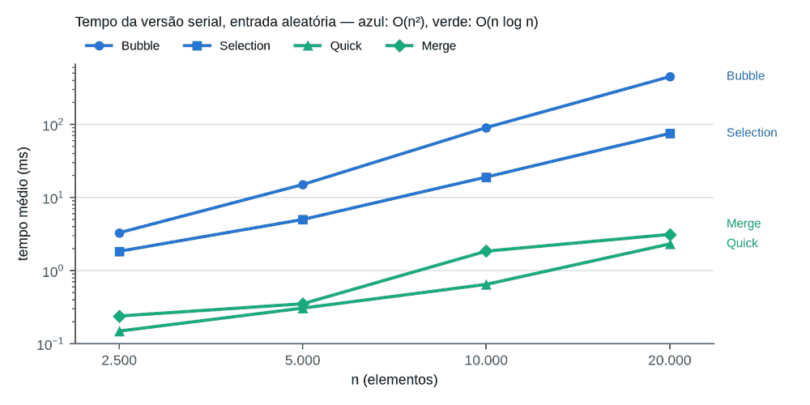
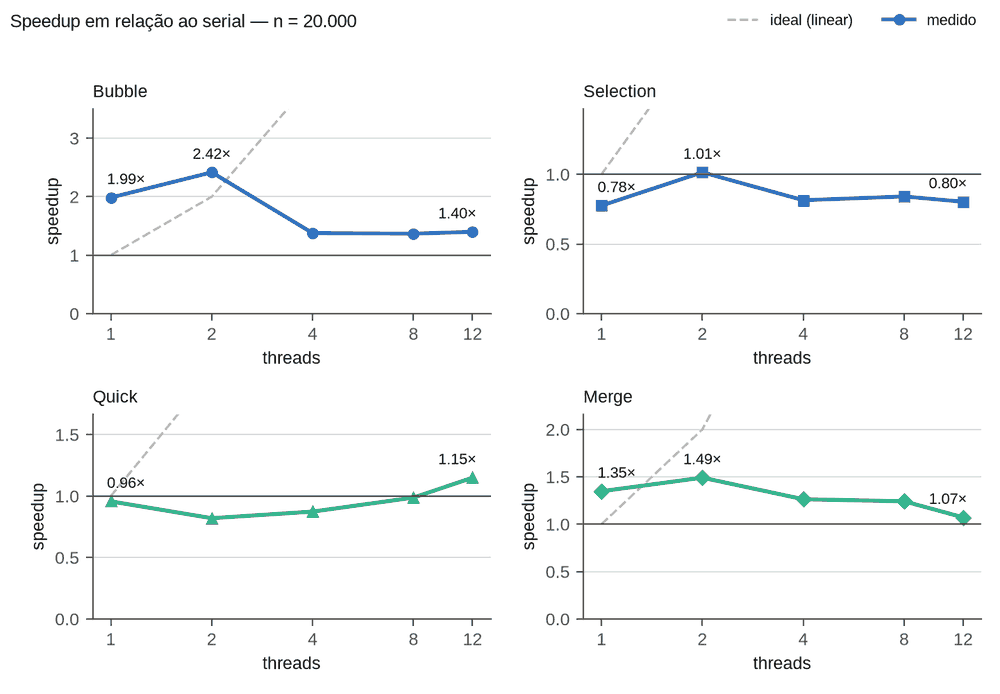
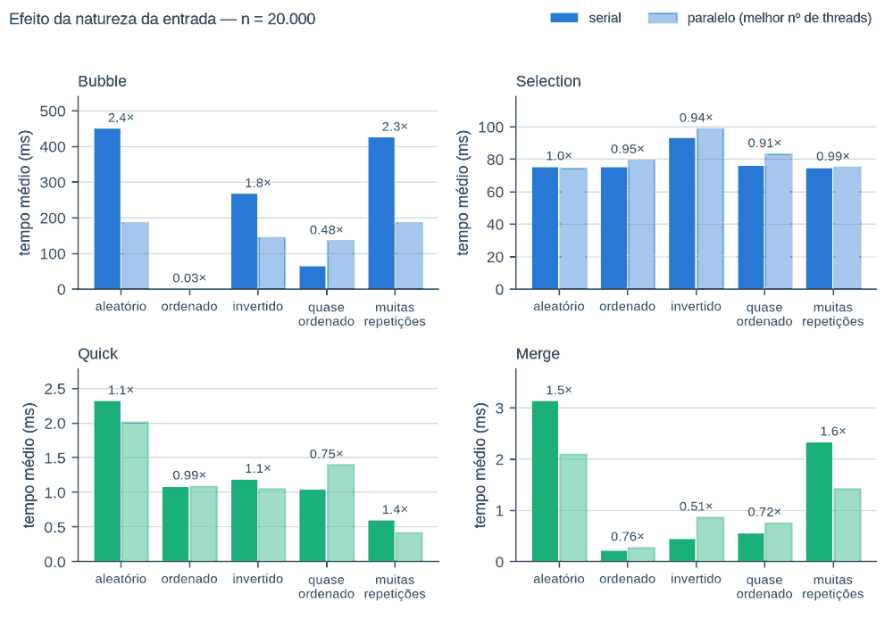

# Ordenação Sequencial e Paralela em Java

### Avaliação experimental de quatro algoritmos sob o framework Fork/Join

**Universidade de Fortaleza** · Centro de Ciências Tecnológicas · Ciência da Computação

| Autor | Matrícula |
|-------|-----------|
| Luis Eduardo | 2413528 |
| Theo Passos | 2416515 |

**Palavras-chave:** Algoritmos de ordenação. Computação paralela. Framework Fork/Join. Java. Análise de desempenho.

---

## Resumo

Este trabalho avalia experimentalmente se a paralelização de algoritmos clássicos de ordenação compensa em vetores de porte pequeno a médio. Foram implementados em Java os algoritmos Bubble Sort, Selection Sort, Quick Sort e Merge Sort, cada um em versão sequencial e em versão paralela construída sobre o framework Fork/Join, e todos foram medidos em quatro tamanhos de entrada (2.500 a 20.000 elementos), cinco naturezas de entrada e cinco configurações de threads, totalizando 2.400 medições. Os resultados mostram que a escolha da classe de complexidade domina qualquer ganho obtido com paralelismo: em n = 20.000 o Bubble Sort sequencial gasta 449,67 ms contra 2,32 ms do Quick Sort sequencial, uma razão de 194 vezes. O maior speedup observado foi de 2,42 vezes, e em três dos quatro algoritmos o melhor desempenho ocorre com apenas duas threads, degradando a partir daí. Conclui-se que, nesta faixa de n, o custo de criação e sincronização de tarefas supera o trabalho útil distribuído, e que existe um tamanho mínimo de entrada abaixo do qual paralelizar é contraproducente.

## Introdução

Ordenação é uma das operações mais estudadas da computação e serve como caso de teste natural para avaliar estratégias de paralelização, porque reúne algoritmos com classes de complexidade bem conhecidas e com estruturas de dependência de dados muito diferentes entre si. Alguns deles se decompõem com facilidade em subproblemas independentes; outros são intrinsecamente sequenciais na sua formulação clássica e só admitem paralelismo depois de reformulados.

Foram escolhidos quatro métodos, dois de complexidade quadrática e dois de complexidade linearítmica, de modo a cobrir os dois regimes. O **Bubble Sort** percorre repetidamente o vetor trocando pares vizinhos fora de ordem, é O(n²) no caso médio e conta com uma flag de parada antecipada que o torna O(n) quando a entrada já está ordenada. O **Selection Sort** localiza o menor elemento do subvetor ainda não ordenado e o coloca na posição corrente, com custo O(n²) em todos os casos, já que a busca pelo mínimo varre o restante do vetor independentemente do conteúdo. O **Quick Sort** particiona o vetor em torno de um pivô e ordena recursivamente as duas partes, com custo médio O(n log n). O **Merge Sort** divide o vetor ao meio, ordena cada metade recursivamente e intercala as duas sequências ordenadas, com custo O(n log n) garantido em qualquer entrada.

As quatro versões paralelas compartilham a mesma arquitetura. Todas expõem a assinatura `sort(int[] a, int threads)`, instanciam um `ForkJoinPool` com o número de threads pedido e recaem na implementação sequencial correspondente quando o subproblema fica abaixo de um limiar `LIMITE`, fixado em 10.000 elementos para Quick e Merge e em 16.384 para Bubble e Selection. O limiar existe porque criar e escalonar uma tarefa para um trecho pequeno custa mais do que ordenar esse trecho diretamente.

No **Merge Sort** a paralelização é imediata: as duas metades do vetor são regiões disjuntas de memória e podem ser ordenadas como tarefas simultâneas, submetidas por `invokeAll`. A intercalação final permanece sequencial, pois precisa das duas metades já ordenadas e escreve de forma ordenada no vetor auxiliar.

No **Quick Sort** a partição é executada primeiro e os dois lados do pivô, também disjuntos, viram tarefas independentes. A implementação usa partição de três vias, no esquema da bandeira nacional holandesa descrito por Dijkstra (1976), que separa o vetor em elementos menores, iguais e maiores que o pivô. Sem esse cuidado, uma entrada com poucos valores distintos faz todos os elementos iguais caírem do mesmo lado da partição e a recursão degenera para O(n²).

O **Bubble Sort** clássico não admite paralelização direta, porque a comparação do par (j, j+1) depende do resultado da troca feita no par anterior. Foi adotada a variante par-ímpar, conhecida como *odd-even transposition sort*, que alterna duas fases: na fase par são comparados os pares (0,1), (2,3) e assim por diante; na fase ímpar, os pares (1,2), (3,4) e seguintes. Dentro de uma mesma fase nenhum par compartilha índice com outro, de modo que todas as comparações daquela fase podem ocorrer em paralelo. O algoritmo encerra após duas fases consecutivas sem nenhuma troca, condição que garante que todos os pares vizinhos foram verificados.

No **Selection Sort** a busca pelo menor elemento do subvetor restante é reescrita como uma redução paralela: o intervalo é dividido entre tarefas que devolvem o índice do mínimo local, e os mínimos parciais são combinados. O laço externo permanece sequencial, já que a i-ésima troca depende de todas as trocas anteriores terem posicionado corretamente os elementos à esquerda.

O objetivo do trabalho é medir, sob condições controladas, quanto cada uma dessas estratégias efetivamente rende, e identificar em que condições o paralelismo compensa o seu próprio custo.

## Metodologia

Os experimentos foram executados em uma máquina com processador Intel Core i5-13420H, de 12 núcleos lógicos, sistema operacional Linux e OpenJDK 27. Todo o código foi escrito em Java, sem bibliotecas externas, e a medição é feita por uma classe `Benchmark` que percorre exaustivamente o espaço de configurações.

Foram usados quatro tamanhos de entrada: n igual a 2.500, 5.000, 10.000 e 20.000 elementos. Para cada tamanho foram geradas cinco naturezas de entrada: aleatória, ordenada de forma crescente, invertida, quase ordenada (vetor ordenado com 1% das posições trocadas aleatoriamente) e com muitas repetições (apenas dez valores distintos). Os vetores são produzidos por um gerador com semente fixa, derivada do tamanho, o que torna o experimento reprodutível e garante que os quatro algoritmos recebam exatamente o mesmo vetor em cada configuração.

Cada algoritmo foi medido na versão sequencial e na versão paralela com 1, 2, 4, 8 e 12 threads. A combinação de 4 algoritmos, 4 tamanhos, 5 naturezas de entrada e 6 versões (uma sequencial e cinco paralelas) resulta em 480 configurações distintas. De cada configuração foram coletadas 5 amostras independentes, totalizando 2.400 medições, registradas em `resultados/tempos.csv`.

Duas precauções foram tomadas contra distorções de medição. A primeira é o aquecimento: antes de medir qualquer configuração, cada algoritmo é executado seis vezes sobre um vetor descartável, para que o compilador JIT já tenha compilado os caminhos quentes; sem isso as primeiras amostras ficam artificialmente infladas. A segunda é a verificação de corretude: ao fim de cada execução cronometrada o vetor resultante é percorrido para confirmar que está efetivamente ordenado, de modo que nenhum tempo registrado corresponda a uma ordenação incorreta. O cronômetro usa `System.nanoTime` e mede apenas a chamada de ordenação, com o vetor de entrada já clonado fora da região medida.

Sobre esses dados foi feita a análise estatística dos resultados obtidos para identificar padrões de desempenho e comparar os algoritmos sob diferentes condições. Para cada uma das 480 configurações foram calculados a média e o desvio padrão amostral das 5 repetições, consolidados em `resultados/resumo.csv`. A partir das médias foi calculado o speedup de cada configuração paralela, definido como a razão entre o tempo médio da versão sequencial e o tempo médio da versão paralela sob a mesma entrada e o mesmo tamanho, de forma que valores acima de 1,00 indicam ganho e valores abaixo indicam perda. O desvio padrão foi convertido em desvio relativo, isto é, o desvio dividido pela média, para permitir comparar a dispersão entre configurações cujos tempos diferem em ordens de grandeza. As comparações foram organizadas em três cortes: tempo sequencial contra n, para expor a classe de complexidade; speedup contra número de threads, para expor a escalabilidade; e tempo sequencial contra paralelo por natureza de entrada, para expor a sensibilidade ao conteúdo do vetor.

## Resultados e Discussão

A Tabela 1 apresenta os tempos médios das versões sequenciais sobre entrada aleatória, em milissegundos.

| Algoritmo | n = 2.500 | n = 5.000 | n = 10.000 | n = 20.000 |
|-----------|----------:|----------:|-----------:|-----------:|
| Bubble    | 3,29      | 15,03     | 90,39      | 449,67     |
| Selection | 1,84      | 5,00      | 19,04      | 75,29      |
| Quick     | 0,15      | 0,31      | 0,65       | 2,32       |
| Merge     | 0,24      | 0,35      | 1,85       | 3,13       |

*Tabela 1 — Tempo médio da versão sequencial sobre entrada aleatória, em milissegundos, média de 5 amostras.*

A separação entre as duas classes de complexidade é nítida e cresce com n. Ao quadruplicar a entrada de 5.000 para 20.000 elementos, o Bubble Sort passa de 15,03 ms para 449,67 ms, um fator de 29,9, acima do fator 16 que um crescimento puramente quadrático preveria, diferença atribuível aos efeitos de cache; no mesmo intervalo o Quick Sort passa de 0,31 ms para 2,32 ms. A Figura 1 mostra esse comportamento em escala logarítmica nos dois eixos, em que uma relação de potência aparece como reta e o coeficiente angular corresponde ao expoente da complexidade. As duas retas superiores, em azul, correspondem aos algoritmos O(n²) e são visivelmente mais inclinadas que as duas inferiores, em verde, dos algoritmos O(n log n).



*Figura 1 — Tempo médio da versão sequencial em função de n, entrada aleatória, escala logarítmica nos dois eixos. Em azul os algoritmos O(n²), em verde os O(n log n).*

O primeiro achado do experimento é que a classe de complexidade domina qualquer outro fator. Em n = 20.000 o Bubble Sort sequencial gasta 449,67 ms contra 2,32 ms do Quick Sort sequencial, uma razão de 194 vezes. Nenhum ganho de paralelismo medido neste trabalho chega perto de compensar a escolha de um algoritmo quadrático: seria necessário um speedup de duas ordens de grandeza, muito além dos 12 núcleos disponíveis, apenas para igualar a versão sequencial de um algoritmo O(n log n).

A Tabela 2 apresenta o speedup das versões paralelas em n = 20.000 sobre entrada aleatória, em função do número de threads.

| Algoritmo | 1 thread | 2 threads | 4 threads | 8 threads | 12 threads |
|-----------|---------:|----------:|----------:|----------:|-----------:|
| Bubble    | 1,99     | 2,42      | 1,38      | 1,37      | 1,40       |
| Selection | 0,78     | 1,01      | 0,81      | 0,84      | 0,80       |
| Quick     | 0,96     | 0,82      | 0,87      | 0,99      | 1,15       |
| Merge     | 1,35     | 1,49      | 1,26      | 1,24      | 1,07       |

*Tabela 2 — Speedup (tempo sequencial dividido pelo tempo paralelo) em n = 20.000, entrada aleatória.*



*Figura 2 — Speedup em função do número de threads, um painel por algoritmo, em n = 20.000 com entrada aleatória. A reta tracejada marca o speedup linear ideal.*

Este é o resultado central do trabalho e ele é negativo: nesta faixa de n o paralelismo praticamente não compensa. Considerando apenas as 150 configurações em que o caminho paralelo é de fato percorrido, isto é, aquelas cujo tamanho supera o limiar de corte, o maior speedup de todo o experimento é 2,42 vezes, obtido pelo Bubble Sort com 2 threads em n = 20.000 sobre entrada aleatória. Em três dos quatro algoritmos o melhor speedup ocorre justamente com 2 threads e cai a partir daí; apenas o Quick Sort tem máximo em 12 threads, e ainda assim com modestos 1,15 vezes. A Figura 2 torna visível a distância entre as curvas medidas e a reta de speedup linear, que já na segunda thread se afasta das medições em todos os painéis. Selection e Quick sequer ultrapassam de forma consistente a marca de 1,00, ou seja, suas versões paralelas são em média mais lentas que as sequenciais.

A explicação está na granularidade do trabalho distribuído. Nas versões paralelas de Bubble e Selection existe uma barreira de sincronização por fase ou por iteração do laço externo, o que significa da ordem de n barreiras ao longo de uma execução; com n = 20.000 cada pedaço de trabalho entre duas barreiras é curto demais para amortizar o custo de criar, escalonar e sincronizar as tarefas. Em Quick e Merge o problema é ainda mais direto: ordenar 20.000 elementos leva entre 1 e 3 ms, tempo da mesma ordem de grandeza do custo de instanciar um `ForkJoinPool` e submeter as primeiras tarefas. Some-se a isso o efeito dos limiares: com `LIMITE` igual a 10.000, um vetor de 20.000 elementos sofre apenas um nível de divisão paralela antes de toda a recursão passar ao caminho sequencial, de modo que no máximo duas tarefas chegam a executar simultaneamente. Isso explica tanto o teto próximo de 2 quanto a ausência de ganho ao passar de 2 para 12 threads: as threads adicionais não recebem trabalho.

O caso do Bubble Sort merece uma ressalva, porque o seu speedup de 2,42 não é inteiramente devido ao paralelismo. Com uma única thread a versão paralela já registra 1,99, e com uma thread não há execução simultânea alguma: esse ganho vem da própria variante par-ímpar, que percorre o vetor em um padrão de acesso mais regular que o laço clássico. Descontado esse efeito, a contribuição atribuível à segunda thread é de apenas 2,42 dividido por 1,99, ou seja, 1,22 vezes. A comparação entre sequencial e paralelo mistura, nesse algoritmo, duas mudanças distintas, e apenas uma delas é paralelismo.

Um indício independente do mesmo fenômeno aparece nos tamanhos menores. Com n abaixo de 16.384, as versões paralelas de Bubble e Selection desviam integralmente para a implementação sequencial, executando exatamente o mesmo código. Os speedups medidos nessas 150 configurações deveriam portanto ser 1,00 exatos, mas variam de 0,87 a 1,80, o que fornece uma medida direta do ruído experimental nesta escala de tempo e estabelece o piso de incerteza abaixo do qual nenhum resultado de speedup deve ser interpretado. Em Quick e Merge abaixo do limiar, o `ForkJoinPool` ainda é instanciado antes do desvio para o caminho sequencial, e o speedup mediano dessas configurações é de 0,40, isolando o custo da infraestrutura de paralelismo quando ela não executa trabalho útil algum.

A Tabela 3 apresenta os tempos sequenciais em n = 20.000 para as cinco naturezas de entrada.

| Algoritmo | Aleatória | Ordenada | Invertida | Quase ordenada | Repetições |
|-----------|----------:|---------:|----------:|---------------:|-----------:|
| Bubble    | 449,67    | 0,01     | 266,73    | 65,17          | 424,66     |
| Selection | 75,29     | 75,20    | 93,27     | 76,01          | 74,46      |
| Quick     | 2,32      | 1,08     | 1,19      | 1,04           | 0,59       |
| Merge     | 3,13      | 0,21     | 0,44      | 0,54           | 2,33       |

*Tabela 3 — Tempo médio da versão sequencial por natureza da entrada, em n = 20.000, em milissegundos.*



*Figura 3 — Tempo sequencial e tempo paralelo, no melhor número de threads, para as cinco naturezas de entrada, em n = 20.000.*

A Tabela 3 revela dois comportamentos opostos. O Selection Sort é indiferente ao conteúdo do vetor: seus tempos ficam entre 74,46 ms e 93,27 ms nas cinco naturezas de entrada, de modo que o pior caso supera o melhor em apenas 25%. Isso confirma na prática que a busca pelo mínimo varre todo o subvetor restante independentemente do que ele contenha, e que o algoritmo é O(n²) no melhor, no médio e no pior caso.

O Bubble Sort é o extremo oposto. Sobre vetor já ordenado gasta 0,01 ms, porque a flag de parada antecipada encerra a execução após uma única passada sem trocas, reduzindo o algoritmo a O(n); sobre vetor aleatório gasta 449,67 ms. São quatro ordens de grandeza de diferença produzidas apenas pela natureza da entrada. Esse mesmo caso produz o pior resultado de paralelização de todo o experimento: na entrada ordenada a versão paralela leva 0,23 ms contra 0,01 ms da sequencial, cerca de 34 vezes mais lenta, porque paga integralmente o custo de montar as tarefas da primeira fase par-ímpar para um trabalho que a versão sequencial resolve em uma única varredura. A entrada quase ordenada mostra o mesmo efeito de forma atenuada, com speedup de 0,48. A Figura 3 reúne esses contrastes: no painel do Bubble a barra do caso ordenado é invisível na escala do caso aleatório, e nos casos ordenado e quase ordenado a barra paralela ultrapassa a sequencial.

O terceiro padrão de interesse está na coluna de repetições. O Quick Sort registra ali 0,59 ms, o menor tempo de toda a Tabela 3, apesar de a entrada com apenas dez valores distintos ser classicamente o pior caso do algoritmo. O resultado é consequência direta da partição de três vias: todos os elementos iguais ao pivô são posicionados definitivamente em uma única passada e saem da recursão, de modo que a profundidade fica limitada pela quantidade de valores distintos e não pelo tamanho do vetor. Em contraste, o Merge Sort gasta 2,33 ms na mesma entrada, praticamente o mesmo que na entrada aleatória, por executar o mesmo número de comparações e cópias qualquer que seja o conteúdo.

Cabe declarar uma limitação metodológica que condiciona a leitura dos resultados de speedup. O desvio relativo mediano entre as 5 amostras de uma mesma configuração é de 8,6% considerando as 480 configurações, mas esse valor agrega regimes muito diferentes. Nas 197 configurações cujo tempo médio supera 2 ms a mediana do desvio relativo cai para 1,6%, enquanto nas 240 configurações de Quick e Merge, quase todas abaixo desse patamar, ela sobe para 17,6%, com casos isolados superiores a 100%. Em tempos dessa ordem a medição se confunde com o ruído do sistema operacional e com a atividade residual do compilador JIT, e diferenças de speedup de poucos décimos não são distinguíveis do erro experimental. Medir Quick e Merge com n na casa dos milhões, onde o tempo de ordenação passa a ser muito maior que o custo fixo do `ForkJoinPool`, produziria curvas de speedup consideravelmente mais confiáveis. Essa extensão ficou como trabalho futuro.

## Conclusão

O experimento mediu quatro algoritmos de ordenação em versão sequencial e paralela sobre 480 configurações e 2.400 amostras, e sustenta três conclusões.

A primeira é que a escolha do algoritmo pesa muito mais que a paralelização. A diferença de 194 vezes entre o Bubble Sort e o Quick Sort sequenciais em n = 20.000 é maior que qualquer ganho obtenível com 12 núcleos, e nenhum esforço de engenharia paralela recupera uma decisão algorítmica ruim nesta faixa de tamanho.

A segunda é que, nesta faixa de n, paralelizar não compensa. O maior speedup registrado foi de 2,42 vezes, e mesmo ele se reduz a 1,22 vezes quando se desconta o ganho que a variante par-ímpar já apresenta com uma única thread. Em três dos quatro algoritmos o melhor resultado ocorre com apenas duas threads, e várias configurações paralelas são mais lentas que as sequenciais. As causas são a granularidade fina do trabalho entre barreiras de sincronização em Bubble e Selection, o custo fixo do `ForkJoinPool` frente a execuções de 1 a 3 ms em Quick e Merge, e os limiares de corte, que com n = 20.000 permitem no máximo um nível de divisão paralela. A conclusão prática é que existe um tamanho mínimo de entrada abaixo do qual o custo de paralelizar supera o rendimento, e que 20.000 elementos está abaixo desse limite nesta implementação e nesta máquina.

A terceira é que a natureza da entrada separa os algoritmos tanto quanto a complexidade assintótica. O Selection Sort é insensível ao conteúdo do vetor, com variação de 25% entre o melhor e o pior caso. O Bubble Sort varia quatro ordens de grandeza entre a entrada ordenada e a aleatória, e é justamente no seu melhor caso que a paralelização produz a maior perda, com a versão paralela cerca de 34 vezes mais lenta que a sequencial. O Quick Sort com partição de três vias transforma a entrada com poucos valores distintos, classicamente seu pior caso, no seu melhor tempo medido.

Como continuação natural do trabalho, a avaliação deveria ser repetida com n na casa dos milhões e com limiares de corte calibrados em relação ao número de núcleos, condições em que o trabalho por tarefa passa a dominar o custo de sincronização e as curvas de speedup podem ser interpretadas com margem de erro aceitável.

## Como reproduzir

```bash
javac -d out src/ordenacao/*.java
java -cp out ordenacao.Benchmark   # resultados/tempos.csv
python3 scripts/graficos.py        # resultados/resumo.csv + figuras
```

## Referências

CORMEN, T. H.; LEISERSON, C. E.; RIVEST, R. L.; STEIN, C. *Algoritmos: teoria e prática*. 3. ed. Rio de Janeiro: Elsevier, 2012.

DIJKSTRA, E. W. *A discipline of programming*. Englewood Cliffs: Prentice-Hall, 1976.

GRAMA, A.; GUPTA, A.; KARYPIS, G.; KUMAR, V. *Introduction to parallel computing*. 2. ed. Harlow: Addison-Wesley, 2003.
